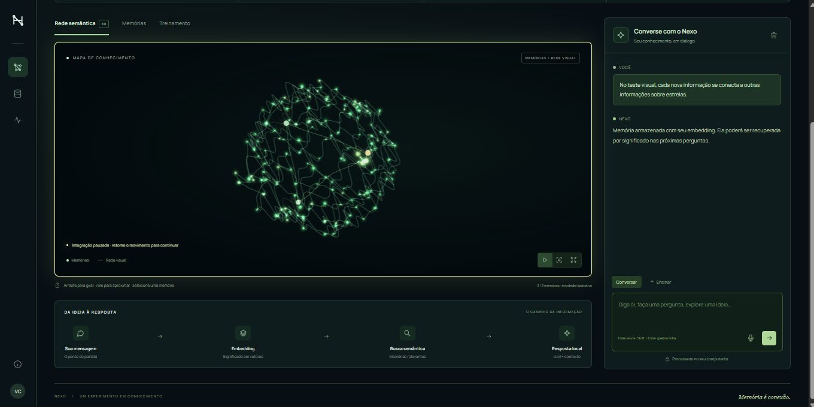

# Nexo · Neural Learning Lab

**Laboratório interativo de deep learning, memória vetorial e RAG.**

[Abrir aplicação](https://vitorcostalv.github.io/nexo-neural-lab/) · [Relatório técnico](docs/PRODUCAO.md)



Projeto de estudo de **Vitor Costa**: converse com uma LLM, ensine informações, inspecione embeddings e treine uma rede neural para reconhecer categorias. Cada memória ganha um nó no mapa 3D, com animação de nascimento e conexão. Uma projeção 2D atende dispositivos sem WebGL.

| | Web gratuita | Python local |
|---|---|---|
| Execução | Navegador, sem servidor de IA | FastAPI + Ollama |
| LLM | Qwen2.5 0.5B Instruct, ONNX q4 | Qwen3 4B Instruct 2507 |
| Embeddings | MiniLM multilíngue, 384 dimensões | EmbeddingGemma 300M, 768 dimensões |
| Memória | IndexedDB por navegador | SQLite no computador |
| Rede treinável | JavaScript em Web Worker | NumPy, CPU |
| Voz | Ditado do teclado do dispositivo | Whisper local opcional |
| Hospedagem | GitHub Pages + Actions | Sua máquina |

## O que realmente aprende?

O classificador é um **MLP treinável**, com duas camadas ocultas de 64 e 24 neurônios, ReLU e saída softmax. Usa backpropagation, Adam, regularização L2, divisão por categoria entre treino e validação, parada antecipada e restauração dos melhores pesos. A inicialização usa a semente 42. Os hiperparâmetros diferem entre as implementações Python e JavaScript.

Embeddings e LLM são pré-treinados. **Adicionar uma memória não retreina a LLM.** O RAG encontra informações e as inclui no contexto da pergunta. O MLP aprende categorias dos embeddings; não gera respostas.

O mapa representa memórias e similaridades aproximadas. Neurônios e impulsos de fundo são ilustrativos; não mostram pesos ou atividade interna da LLM.

## Experimente online

1. Mande **oi**: saudações simples respondem imediatamente.
2. Clique em **Nova memória** e guarde uma informação fictícia: “O observatório Aurora fica em Recife”. O primeiro uso baixa o modelo de embeddings.
3. Pergunte “Em qual cidade fica o observatório Aurora?”. A busca compara embeddings por cosseno; até cinco memórias relevantes entram no contexto da LLM.
4. Em **Treinamento**, adicione os 18 exemplos didáticos e treine. Veja curvas de perda e resultados separados de treino e validação.
5. Use **Exportar** para guardar uma cópia dos textos e categorias.

**Primeiro carregamento:** aproximadamente 650 MB em modelos, além do runtime. Downloads podem levar minutos e exigem internet e espaço no dispositivo. A aplicação informa o progresso. WebGPU acelera a geração quando disponível; WebAssembly oferece execução em CPU. Dispositivos com pouca memória podem não carregar a LLM. O modelo compacto tem capacidade e qualidade inferiores à edição local, especialmente em português.

Memórias ficam no navegador e não são sincronizadas. Limpar dados do site, usar navegação privada ou perder o dispositivo pode apagá-las. Exporte regularmente. Use uma aba por vez para editar a base. Arquivos exportados podem ser importados em ambas as edições; embeddings são recalculados no destino.

## Edição web em desenvolvimento

Requisitos: Node.js 22+ e servidor HTTP estático.

```sh
node scripts/build-web.mjs
python -m http.server 8020 --directory dist --bind 127.0.0.1
```

Acesse `http://127.0.0.1:8020`. Modelos e bibliotecas são baixados de Hugging Face e jsDelivr, com versão da biblioteca fixada no código. O navegador reutiliza o cache quando disponível. Não há chave de API nem cobrança por inferência no servidor.

## Edição Python

Requisitos: Python 3.12+ e [Ollama](https://ollama.com/download). RAM/VRAM e armazenamento devem comportar os modelos escolhidos. Pesos, ambiente virtual, bancos e executáveis não são incluídos.

```sh
python -m venv .venv
# Windows: .venv\Scripts\activate
# Linux/macOS: source .venv/bin/activate
pip install -r requirements.txt
```

Configure Ollama em um terminal dedicado:

```powershell
# PowerShell; Linux/macOS: export OLLAMA_HOST=127.0.0.1:11435
$env:OLLAMA_HOST='127.0.0.1:11435'
ollama serve
```

Em outro terminal, configure o mesmo endereço e inicie:

```powershell
$env:OLLAMA_HOST='127.0.0.1:11435'
ollama pull qwen3:4b-instruct-2507-q4_K_M
ollama pull embeddinggemma:300m
.venv\Scripts\python.exe -m uvicorn app.main:app --host 127.0.0.1 --port 8000
```

Acesse `http://127.0.0.1:8000`; API interativa em `/docs`. Variáveis opcionais estão em `.env.example`. Linux/macOS: substitua o executável por `.venv/bin/python` e adapte a sintaxe de variáveis.

`start.cmd` / `stop.cmd` são atalhos Windows para uma instalação portátil existente, com Ollama completo em `runtime/ollama/` e pesos em `models/`. Não são instaladores. Para instalação nova, use o procedimento acima. Whisper é opcional: instale o modelo antes de usar o microfone com `python -c "from huggingface_hub import snapshot_download; snapshot_download('Systran/faster-whisper-small', local_dir='models/whisper-small')"`.

## Arquitetura

```text
Texto -> embedding normalizado -> armazenamento vetorial
Pergunta -> embedding -> cosseno/top-k -> contexto -> LLM -> streaming
Exemplos rotulados -> embeddings -> MLP 64/24 -> categoria + softmax
Memórias -> projeção 3D -> nós e sinapses animados
```

| Pasta | Responsabilidade |
|---|---|
| `app/neural/` | API, SQLite, RAG, conversa, MLP NumPy |
| `app/ollama_client.py` | Cliente e streaming da inferência local |
| `lab-web/browser/` | Persistência e inferência da edição web |
| `lab-web/neural-*.js` | Visualização 3D/2D e animações |
| `tests/`, `lab-web/tests/` | Testes sem baixar modelos |
| `scripts/build-web.mjs` | Build estático com caminhos relativos |
| `.github/workflows/` | Validação e publicação contínua |

## Verificação

```sh
pip install -r requirements-dev.txt
python -m pytest -q
node --test lab-web/tests/*.test.js
node scripts/build-web.mjs
```

Na preparação da publicação: **44 testes Python e 20 JavaScript passaram**. Cobrem persistência, autenticação local, deduplicação, streaming, bloqueios, treinamento, busca vetorial e animações. Isso não garante correção factual de todas as respostas. Validação com poucos exemplos não comprova generalização; softmax não fornece probabilidades calibradas.

## Privacidade e limites

Na web, inferência ocorre no dispositivo. Textos não são enviados a uma API de IA; provedores de arquivos recebem requisições normais de download. Não há analytics adicionado pelo projeto. GitHub Pages hospeda arquivos estáticos. Na edição Python, inferência e banco são locais. A API Python foi projetada para uso pessoal, sem isolamento de múltiplos usuários; mantenha-a em loopback.

A base suporta até 5.000 memórias; o mapa exibe as 180 mais recentes. A busca usa limiar de cosseno 0,4 e até cinco resultados. Pode recuperar informações irrelevantes ou omitir informações úteis. Textos importados são dados não confiáveis. Modelos podem produzir respostas incorretas mesmo com RAG.

## Licenças

Código sob MIT. Three.js e Manrope incluem licenças em `lab-web/vendor/`. Bibliotecas e modelos mantêm suas próprias licenças: [Qwen2.5](https://huggingface.co/Qwen/Qwen2.5-0.5B-Instruct), [MiniLM](https://huggingface.co/sentence-transformers/paraphrase-multilingual-MiniLM-L12-v2), [Transformers.js](https://github.com/huggingface/transformers.js).
